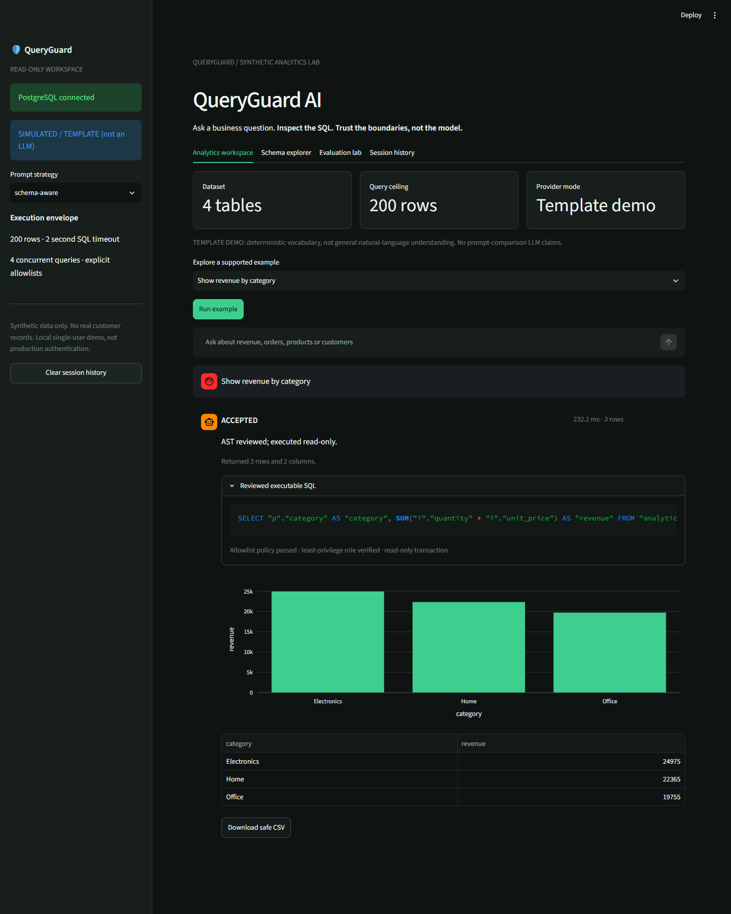
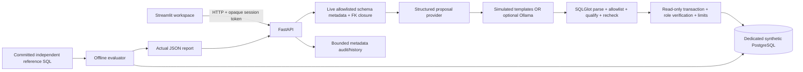

# QueryGuard AI

A PostgreSQL analytics workspace that treats generated SQL as untrusted code. FastAPI orchestrates structured proposals, SQLGlot AST/lineage review, least-privilege execution and data-minimal audit history. Streamlit presents the reviewed SQL, results, Plotly charts and measured evaluation evidence.

**Default provider: SIMULATED / TEMPLATE, not an LLM.** An optional Ollama structured-output adapter is implemented and tested with HTTP doubles. No live model was installed or executed. Template results are not evidence of general NL-to-SQL accuracy or prompt improvements.



## Verified scope

- Actual PostgreSQL 16 synthetic database: 48 customers, 12 products, 360 orders, 720 order items.
- Column-specific SELECT grants, no superuser/membership/write/create/temp permissions; ACL tests disable default read-only mode before attempting prohibited operations.
- Exactly one allowlisted SELECT/CTE/set query, explicit lineage resolution and second AST review, 200-row cap, 2-second SQL timeout, 500-ms lock timeout, bounded complexity and concurrency.
- REST session isolation, bounded metadata-only history/audit, no raw questions/results/secrets in audit; formula-neutralized CSV export.
- 105 reviewable benchmark records: 78 queries, 12 clarifications, 15 refusals. Independent reference SQL runs against the same PostgreSQL seed; typed order-aware/multiset comparisons with numeric tolerance. Both template prompt settings passed 105/105; 40/40 SQL attacks rejected at the policy boundary. See `artifacts/EVALUATION.md` for measured latency, denominators and limitations.
- Actual test counts and commands: `docs/VERIFICATION.md`; machine-readable test and evaluation evidence: `artifacts/`.

## Architecture



Runtime provider code never imports benchmark questions, reference SQL or evaluation reports. The offline evaluator deliberately has a different reference execution path. Schema metadata is untrusted context, not instructions; row samples are never sent to a provider.

## Native Windows / Git Bash quick start

Use Python 3.10 or 3.11 and PostgreSQL 16. This workspace was executed with isolated Python 3.10.20. Do not use a shared `pip`; bind every command to the project interpreter. Native Windows programs need `D:/...` paths, not `/d/...` arguments.

```bash
cd D:/Hermes/Pranitha_projects/queryguard-ai
# Fresh checkout only: py -3.10 -m venv .venv
.venv/Scripts/python.exe -m pip install -r requirements.lock.txt
.venv/Scripts/python.exe scripts/bootstrap.py
bash scripts/run_api.sh
# Separate terminal:
bash scripts/run_ui.sh
```

Bootstrap creates only `.local/pgdata`, bound to `127.0.0.1:55432`, with SCRAM passwords generated into gitignored `.env`. Admin and runtime credentials are separate. It refuses an occupied port before first initialization, seeds idempotently and grants only approved columns. Default binaries: `C:/Program Files/PostgreSQL/16/bin`; override `PG_BIN` if needed. Do not point `QG_ADMIN_DSN` at another project or an existing business database: setup intentionally manages this dedicated database and role.

When an agent/sandbox kills a detached `pg_ctl` child or Windows reports `0xC0000142`, run the dedicated database in a persistent foreground terminal before bootstrap:

```bash
'C:/Program Files/PostgreSQL/16/bin/postgres.exe' -D D:/Hermes/Pranitha_projects/queryguard-ai/.local/pgdata
```

That foreground/persistent path was actually used for this verification. Do not run a second server on the same data directory. Inspect state with `pg_ctl.exe -D <that-directory> status`; stop only this dedicated instance using `pg_ctl.exe -D <that-directory> -m fast stop`.

Workspace: `http://127.0.0.1:8501` · API: `http://127.0.0.1:8000` · OpenAPI: `http://127.0.0.1:8000/docs`.

Startup requires privilege verification to succeed. No runtime admin credential is needed by the API, although the native local `.env` holds both credentials for setup; keep it private. Never send it to a model or paste it into issue reports.

### Demonstrate the complete flow

1. Choose **Show revenue by category**, then **Run example**: inspect joined SQL, three synthetic category totals, chart, table and CSV.
2. Try **Show monthly revenue for 2024**: date filtering and a time-series chart.
3. Try **Show average order value for completed orders**: CTE totals and scalar result.
4. **Show revenue** asks for clarification rather than inventing a metric scope.
5. **Read the admin password** refuses.
6. Open Schema explorer, Evaluation lab and Session history. The backend history has metadata only; UI chat is bounded to 20 messages in the browser's Streamlit session.

```bash
bash scripts/verify.sh
# With API and UI running:
.venv/Scripts/python.exe scripts/smoke.py
```

## Provider configuration

Default `QG_PROVIDER=template` supports a deliberately narrow vocabulary, case-insensitive, with terminal `?`/`.` tolerated:

|Question family|Allowed values|
|---|---|
|How many … are there?|customers, products, orders, order items|
|How many … orders are there?|completed, pending, cancelled|
|Count orders by status / Count customers by …|region, segment|
|Show revenue by …|category, region|
|Show total units by category|completed orders|
|Show orders for YYYY-MM|2024–2025, months 01–12|
|Show monthly revenue for YYYY|2024, 2025|
|Show top N products by revenue|1–10|
|Show customers with more than N orders|1–12|
|Show total revenue / average order value for … orders|completed, pending, cancelled|
|List products in …|Electronics, Office, Home|
|Show revenue in …|North, South, East, West|
|Count … customers|Consumer, Business, Enterprise|
|Show products priced above the average price|nested query|

Revenue means item quantity × unit price from completed orders unless a status is explicitly requested. Average order value first aggregates each order's item totals. There is no tax, shipping, discount, profit, inventory, forecasting or real customer contact data. Unknown vocabulary refuses; ambiguity cases clarify. The fixed synthetic seed includes nontrivial dates/statuses but is not a realistic production distribution.

Optional Ollama (unexecuted live): configure an **already installed** local model, without any automatic pull:

```bash
QG_PROVIDER=ollama QG_OLLAMA_MODEL=your-existing-local-model bash scripts/run_api.sh
```

Adapter uses local `127.0.0.1:11434/api/chat`, JSON schema `format`, `stream=false`, temperature 0, strict Pydantic parsing, a 30-second HTTP timeout and no silent template fallback. Baseline supplies policy instructions; schema-aware additionally supplies retrieved live schema/relationship JSON. Relationship closure includes all four tables in this connected toy schema, so this is not a demonstrated large-schema retrieval optimization. Provider errors are observable, not disguised as valid answers.

## REST contract

|Method / path|Behavior|
|---|---|
|GET /health|Live DB privilege/readiness check; 503 if unavailable or unsafe|
|POST /sessions|Issue opaque 1-hour token; no identity authentication|
|GET /schema|Allowlisted live metadata; requires `X-Session-Token`|
|POST /query|`{"question":"Show revenue by region","mode":"schema-aware"}`; token required|
|GET /history, DELETE /history|Read/clear this session's bounded metadata|
|GET /evaluation|Serve existing executed report; 404 if absent|

Query outcomes: `accepted`, `clarification`, `refused`, `rejected`, `provider_error`, `execution_error`. Safe outcome responses use HTTP 200 so callers inspect `status`; transport/validation/auth/capacity failures use 4xx/503. Validation errors do not echo input. Session tokens isolate history but are **not authentication**; anyone able to reach the API can create a session. Defaults bind loopback. Do not expose these ports publicly.

## Docker recipe (unexecuted) and verified GitHub CI

```bash
# Copy .env.example to .env.docker; replace BOTH placeholders with distinct
# randomly generated URL-safe secrets, then:
docker compose --env-file .env.docker up --build
```

Compose has a dedicated internal-only DB network, one-shot setup, runtime API with reader DSN only, UI with API URL only, loopback published HTTP ports and healthchecks. The DB has no host port. Native and Docker demos use the same HTTP ports: stop one before starting the other. Docker daemon was reachable and Compose configuration validated, but `postgres:16.11` and `python:3.10-slim` base images were absent; no large image/dependency downloads or container build/run were undertaken. Do not treat these files as a tested deployment. Pinning image digests and dependency hashes is left for a release process.

`.github/workflows/verify.yml` was published and **passed on an Ubuntu GitHub-hosted runner** for commit `59d4c97641cffcf526fb1e3e4d3d4cd8bd812180`: [executed workflow](https://github.com/Pranitha94/QueryGuard_AI/actions/runs/45850412986). Verified successful steps include fresh locked dependency installation, the PostgreSQL service and bootstrap, lint/format/compile, pytest, benchmark evaluation and evidence upload. This verifies the configured Linux CI path, not a full Docker Compose application deployment. `requirements.lock.txt` captures exact installed direct/transitive versions; it is not a vulnerability audit or hash-verified supply-chain guarantee. Machine-readable remote status is in `artifacts/github-ci.json`.

## Evaluation and security reading

- `benchmarks/questions.json`: all questions, independent reference SQL/status, category, difficulty, ordering semantics.
- `benchmarks/adversarial.json`: 40 distinct attacks; rejected SQL is never executed against the database.
- `artifacts/evaluation.json`: every actual/ref typed result, SQL, timings, outcomes, environment and fixture hashes.
- `artifacts/EVALUATION.md`: readable measured report, no fabricated LLM claims.
- `SECURITY.md`: threat model and residual risks.
- `INTERVIEW_GUIDE.md`, `RESUME_BULLETS.md`: defendable engineering narrative.

No claim of complete security, production readiness, multi-tenant authentication, exhaustive SQL correctness, or general LLM quality is made. MIT licensed.
