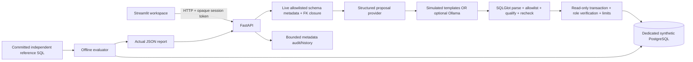

# QueryGuard AI

A PostgreSQL analytics workspace that treats generated SQL as untrusted code. FastAPI orchestrates structured proposals, SQLGlot AST/lineage review, least-privilege execution and data-minimal audit history. Streamlit presents the reviewed SQL, results, Plotly charts and measured evaluation evidence.

**Default provider: SIMULATED / TEMPLATE, not an LLM.** An optional Ollama structured-output adapter is implemented and tested with HTTP doubles. No live model was installed or executed. Template results are not evidence of general NL-to-SQL accuracy or prompt improvements.


## Verified scope

- Actual PostgreSQL 16 synthetic database: 48 customers, 12 products, 360 orders, 720 order items.
- Column-specific SELECT grants, no superuser/membership/write/create/temp permissions; ACL tests disable default read-only mode before attempting prohibited operations.
- Exactly one allowlisted SELECT/CTE/set query, explicit lineage resolution and second AST review, 200-row cap, 2-second SQL timeout, 500-ms lock timeout, bounded complexity and concurrency.
- REST session isolation, bounded metadata-only history/audit, no raw questions/results/secrets in audit; formula-neutralized CSV export.
- 105 reviewable benchmark records: 78 queries, 12 clarifications, 15 refusals. Independent reference SQL runs against the same PostgreSQL seed; typed order-aware/multiset comparisons with numeric tolerance. Both template prompt settings passed 105/105; 40/40 SQL attacks rejected at the policy boundary. See `artifacts/EVALUATION.md` for measured latency, denominators and limitations.
- Current test counts and commands: `TEST_RESULTS.md`; historical checkpoints: `docs/VERIFICATION.md`. Machine-readable test/evaluation/audit evidence is under `artifacts/`.

## Current audit and interview package

The repaired native candidate passed **95 tests** with one installed-library deprecation warning. Python 3.11.6, Pillow 13.0.0 and Streamlit 1.67.0 were actually used. A point-in-time OSV query matched no advisories for the 61 repaired pins; this is not proof of complete dependency safety. Seed v2 now differentiates historical prices and customer order counts.

- [Comprehensive audit](AUDIT_REPORT.md), [verified features](VERIFIED_FEATURES.md), [actual test/evaluation results](TEST_RESULTS.md), [known limitations](KNOWN_LIMITATIONS.md)
- [Final resume bullets](RESUME_BULLETS.md), [40 interview questions and answers](INTERVIEW_QUESTIONS.md), [two-minute demo](DEMO_SCRIPT.md), [beginner component guide](COMPONENT_GUIDE.md)

Historical evidence in `docs/VERIFICATION.md` and the prior release CI must not be mistaken for current audit acceptance. Current execution/review scope is recorded in `TEST_RESULTS.md` and `artifacts/audit/`.

## Architecture



Runtime provider code never imports benchmark questions, reference SQL or evaluation reports. The offline evaluator deliberately has a different reference execution path. Schema metadata is untrusted context, not instructions; row samples are never sent to a provider.

## Native Windows / Git Bash quick start

Use **Python 3.11 or 3.12** and PostgreSQL 16, Git and Git Bash. The audit actually used Python 3.11.6; use a security-patched supported interpreter for broader use. Do not reuse a Python 3.10 environment: fixed Pillow 13.0.0 and compatible Streamlit 1.67.0 require Python 3.11+. Bind every command to the project interpreter, not shared `pip`. Native Windows arguments need `D:/...` paths, not `/d/...`.

**Supported distribution: source checkout.** `pip install .` and a standalone application wheel are not supported; package discovery/resources are not configured as a full distribution. `pyproject.toml` supplies tooling/project metadata, not a promise that wheel installation works. Follow these requirements-and-scripts commands.

```bash
git clone https://github.com/Pranitha94/QueryGuard_AI.git
cd QueryGuard_AI
py -3.11 -m venv .venv
.venv/Scripts/python.exe -m pip install -r requirements.lock.txt
.venv/Scripts/python.exe scripts/bootstrap.py
bash scripts/run_api.sh
# In another Git Bash terminal, cd into the same checkout:
bash scripts/run_ui.sh
```

If `py` is unavailable, use an installed Python 3.11/3.12 executable's full path for `-m venv`. Bootstrap initializes only `.local/pgdata` on loopback, generates private SCRAM credentials in ignored `.env`, creates the dedicated `queryguard` database when absent, seeds managed synthetic rows and grants approved columns. It refuses unknown occupied ports/storage or inconsistent endpoints. Default binaries: `C:/Program Files/PostgreSQL/16/bin`; override `PG_BIN` if needed. **Never target an unrelated/production database.** Seed v2 updates its managed item prices/customer assignments on rerun; do not treat setup as read-only.

For a second checkout, select free ports **before its first bootstrap** and use consistent exports in both service terminals:

```bash
export QG_DB_PORT=55435 QG_API_PORT=8002 QG_UI_PORT=8503
export QG_API_URL="http://127.0.0.1:$QG_API_PORT"
.venv/Scripts/python.exe scripts/bootstrap.py
bash scripts/run_api.sh
# Another terminal with the same exports:
bash scripts/run_ui.sh
.venv/Scripts/python.exe scripts/smoke.py --output .local/http-smoke.json
```

Port settings accept integers from 1 to 65535. Existing native `.env` retains its database endpoint; conflicting overrides are refused instead of redirecting an existing cluster. `QG_API_URL` points the UI at the alternate API; an alternate API bind port alone does not change the UI destination.

For an already running dedicated external PostgreSQL server, supply **process environment** `QG_ADMIN_DSN`, `QG_DATABASE_DSN` and `QG_READER_PASSWORD`. Both DSNs must explicitly target `queryguard`; the reader must be `qg_reader`, use the matching password and refer to the same endpoint. Bootstrap now creates an absent `queryguard` database through maintenance `postgres`; admin therefore needs maintenance access and database-creation privilege. No manual DB precreation is needed. External mode is selected by process environment, not an arbitrary `.env` file. Never copy somebody else's generated credentials. Linux external-server setup uses Python 3.11/3.12, `.venv/bin/python` and the same scripts; only the configured backend CI path is verified on Linux, not every desktop installation.

If native initialization succeeds but PostgreSQL startup fails, check only this project's cluster with `pg_ctl.exe -D <this-checkout>/.local/pgdata status`. The foreground workaround requires an **already initialized directory**: run `postgres.exe -D <absolute-native-checkout-path>/.local/pgdata` in a separate persistent terminal only if no server uses that directory, then rerun bootstrap. It does not initialize a cluster. The repaired `pg_ctl` launch avoids inherited captured pipes; no claim is made that every underlying Windows `0xC0000142` cause was diagnosed. Never start two servers on one directory or stop another project's server.

Workspace: `http://127.0.0.1:8501` · API: `http://127.0.0.1:8000` · OpenAPI: `http://127.0.0.1:8000/docs`.

Startup requires privilege verification to succeed. No runtime admin credential is needed by the API, although the native local `.env` holds both credentials for setup; keep it private. Never send it to a model or paste it into issue reports.

### Demonstrate the complete flow

1. Choose **Show revenue by category**, then **Run example**: inspect joined SQL, three synthetic category totals, chart, table and CSV.
2. Try **Show monthly revenue for 2024**: date filtering and a time-series chart.
3. Try **Show average order value for completed orders**: CTE totals and scalar result.
4. **Show revenue** asks for clarification rather than inventing a metric scope.
5. **Read the admin password** refuses.
6. Open Schema explorer, Evaluation lab and Session history. The backend history has metadata only; UI chat is bounded to 20 messages in the browser's Streamlit session.

```bash
bash scripts/verify.sh
# With API and UI running:
.venv/Scripts/python.exe scripts/smoke.py
```

`verify.sh` intentionally writes current test/evaluation reports under `artifacts/`; smoke also updates its saved evidence. Inspect Git status afterward. For a source-clean audit, use:

```bash
QG_EVIDENCE_DIR=.local/evidence bash scripts/verify.sh
.venv/Scripts/python.exe scripts/evaluate.py --output-dir .local/evidence
.venv/Scripts/python.exe scripts/smoke.py \
  --api-url http://127.0.0.1:8000 --ui-url http://127.0.0.1:8501 \
  --output .local/http-smoke.json
```

The UI `/evaluation` endpoint reads **saved `artifacts/evaluation.json`**, not arbitrary redirected evaluator output. A clone initially displays historical committed evidence. Run the evaluator with its default output and refresh to display a newly executed report; inspect timestamp, provider and fixture hashes. Presence of a report is not proof that this installation executed it.

## Provider configuration

Default `QG_PROVIDER=template` supports a deliberately narrow vocabulary, case-insensitive, with terminal `?`/`.` tolerated:

|Question family|Allowed values|
|---|---|
|How many … are there?|customers, products, orders, order items|
|How many … orders are there?|completed, pending, cancelled|
|Count orders by status / Count customers by …|region, segment|
|Show revenue by …|category, region|
|Show total units by category|completed orders|
|Show orders for YYYY-MM|2024–2025, months 01–12|
|Show monthly revenue for YYYY|2024, 2025|
|Show top N products by revenue|1–10|
|Show customers with more than N orders|1–12|
|Show total revenue / average order value for … orders|completed, pending, cancelled|
|List products in …|Electronics, Office, Home|
|Show revenue in …|North, South, East, West|
|Count … customers|Consumer, Business, Enterprise|
|Show products priced above the average price|nested query|

Revenue means item quantity × unit price from completed orders unless a status is explicitly requested. Average order value first aggregates each order's item totals. There is no tax, shipping, discount, profit, inventory, forecasting or real customer contact data. Unknown vocabulary refuses; ambiguity cases clarify. The fixed synthetic seed includes nontrivial dates/statuses but is not a realistic production distribution.

Optional Ollama (unexecuted live): configure an **already installed** local model, without any automatic pull:

```bash
QG_PROVIDER=ollama QG_OLLAMA_MODEL=your-existing-local-model bash scripts/run_api.sh
```

Adapter uses local `127.0.0.1:11434/api/chat`, JSON schema `format`, `stream=false`, temperature 0, strict Pydantic parsing, a 65,536-byte streaming response guard, identity encoding and a 30-second **inactivity/operation timeout, not an end-to-end deadline**. There is no silent template fallback. Baseline supplies policy instructions; schema-aware additionally supplies retrieved live schema/relationship JSON. Relationship closure includes all four tables in this connected toy schema, so this is not a demonstrated large-schema retrieval optimization. Provider errors are observable, not disguised as valid answers.

## REST contract

|Method / path|Behavior|
|---|---|
|GET /health|Live DB privilege/readiness check; 503 if unavailable or unsafe|
|POST /sessions|Issue opaque 1-hour token; no identity authentication|
|GET /schema|Allowlisted live metadata; requires `X-Session-Token`|
|POST /query|`{"question":"Show revenue by region","mode":"schema-aware"}`; token required|
|GET /history, DELETE /history|Read/clear this session's bounded metadata|
|GET /evaluation|Serve existing executed report; 404 if absent|

Query outcomes: `accepted`, `clarification`, `refused`, `rejected`, `provider_error`, `execution_error`. Safe outcome responses use HTTP 200 so callers inspect `status`; transport/validation/auth/capacity failures use 4xx/503. Validation errors do not echo input. Session tokens isolate history but are **not authentication**; anyone able to reach the API can create a session. Defaults bind loopback. Do not expose these ports publicly.

## Docker recipe (application stack unexecuted) and CI provenance

```bash
# Copy .env.example to .env.docker; replace BOTH placeholders with distinct
# randomly generated URL-safe secrets, then:
docker compose --env-file .env.docker up --build
```

Compose has a dedicated internal-only DB network, one-shot setup, runtime API with reader DSN only, UI with API URL only, loopback published HTTP ports and healthchecks. The DB has no host port. Native and Docker demos use the same HTTP ports: stop one before starting the other. The full application Compose build/run was not verified in this audit. Its current recipe uses PostgreSQL 16.11 and Python 3.11; only configuration parsing and the separately recorded CI PostgreSQL-service path are narrower executed evidence. Do not treat these files as a tested deployment. Pinning image digests and dependency hashes is left for a release process.

**Historical release CI:** `.github/workflows/verify.yml` passed on Ubuntu for commit `59d4c97641cffcf526fb1e3e4d3d4cd8bd812180`: [recorded workflow](https://github.com/Pranitha94/QueryGuard_AI/actions/runs/45850412986), with status in `artifacts/github-ci.json`. That run is not approval of later audit changes. The current audit's exact tested revision and CI status, if executed, are recorded in `TEST_RESULTS.md` and `artifacts/audit/`. The workflow installs locked dependencies, seeds a PostgreSQL service and runs lint/format/compile, pytest and evaluation; this does not verify the full application Compose deployment or live inference. Pins are not a vulnerability audit or hash-verified supply-chain guarantee.

## Evaluation and security reading

- `benchmarks/questions.json`: all questions, independent reference SQL/status, category, difficulty, ordering semantics.
- `benchmarks/adversarial.json`: 40 distinct attacks; rejected SQL is never executed against the database.
- `artifacts/evaluation.json`: every actual/ref typed result, SQL, timings, outcomes, environment and fixture hashes.
- `artifacts/EVALUATION.md`: readable measured report, no fabricated LLM claims.
- `SECURITY.md`: threat model and residual risks.
- `INTERVIEW_GUIDE.md`, `RESUME_BULLETS.md`: defendable engineering narrative.

No claim of complete security, production readiness, multi-tenant authentication, exhaustive SQL correctness, or general LLM quality is made. MIT licensed.
